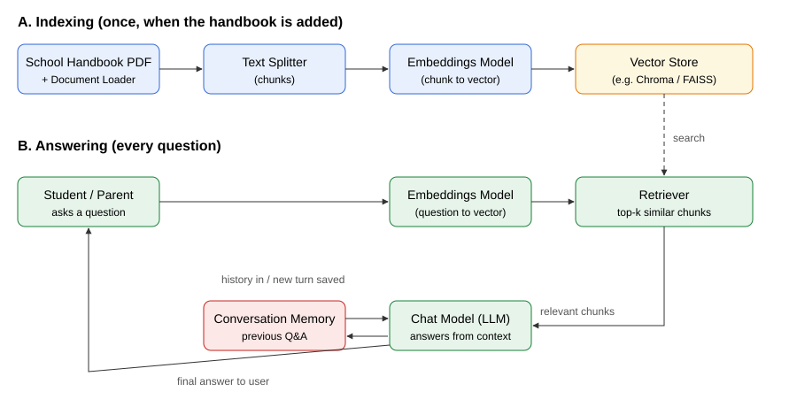
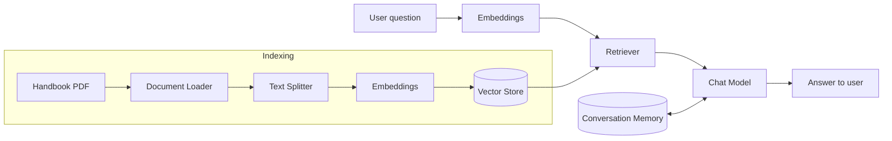

# GenAI_Learning — Tasks 3, 4, 5

## Task 3 – Project setup

```
GenAI_Learning/
|-- .env                 # real key goes here locally (git-ignored)
|-- .env.example         # placeholder copy that is safe to submit
|-- .gitignore           # ignores .env and .venv/
|-- requirements.txt
|-- notebooks/
|   `-- 01_tokenizer.ipynb
|-- apps/
|   `-- chatbot.py
`-- docs/
    `-- architecture.svg # Task 5 diagram
```

Set it up in a VS Code terminal opened in this folder:

```bash
python -m venv .venv
```

```bash
# Windows:  .venv\Scripts\activate      macOS/Linux:
source .venv/bin/activate
```

```bash
pip install -r requirements.txt
```

Once the env is active the prompt starts with `(.venv)`, and VS Code's status bar shows the `.venv` interpreter. Take the "active environment" screenshot at that point. `pip list` and `which python` (`where python` on Windows) show that the venv is being used.

## Task 4 – Chatbot

1. Open `.env` and replace `your_openai_api_key_here` with your real key. Don't commit this file or include it in screenshots.
2. Run `python apps/chatbot.py` and enter each test prompt:
   1. Explain Generative AI in 3 simple sentences.
   2. Give me 5 Python project ideas for beginners.
   3. Write a short motivational message for students learning AI.

The default model is `gpt-4o-mini`, one of the low-cost options. To use another model, set `OPENAI_MODEL` in `.env`. Check https://openai.com/api/pricing before running.

**`.invoke()`** is LangChain's standard way to run a component once. You pass it the input (here, the user's question). It sends the request to the model, waits for the full reply, and returns it as an `AIMessage` object.

**`.content`** is the attribute of that `AIMessage` that holds the reply text. Printing `response.content` shows just the answer. Printing `response` would also show metadata such as token usage, the model name and the message ID.

## Task 5 – School handbook assistant architecture





| Component | Role (one sentence) |
|---|---|
| **Document loading** | A PDF loader (e.g. `PyPDFLoader`) reads the handbook and turns each page into text Documents, which a splitter then cuts into small chunks. |
| **Embeddings** | An embedding model converts each chunk, and each new question, into a numeric vector that captures its meaning. |
| **Vector store** | A database such as Chroma or FAISS stores the chunk vectors so they can be searched by similarity. |
| **Retriever** | The retriever takes the question's vector and returns the top-k handbook chunks most relevant to it. |
| **Chat model** | The LLM writes the final answer using the retrieved chunks as context, so its answers stay grounded in the handbook. |
| **Conversation memory** | Memory stores the previous questions and answers and passes them back to the model, so follow-ups like "what about Year 10?" make sense. |
